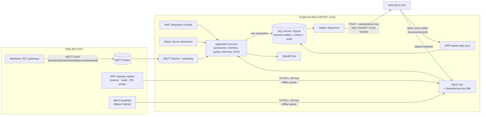
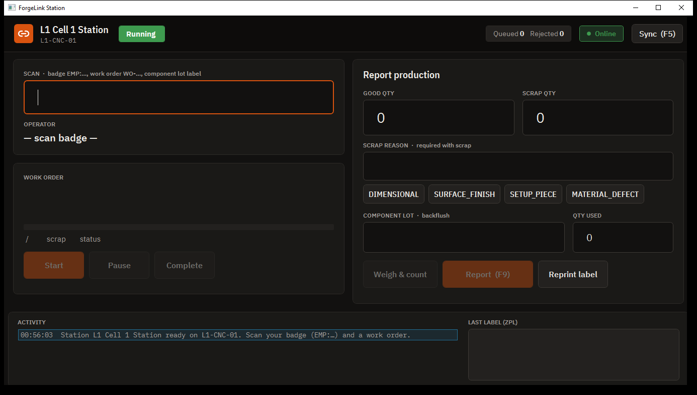
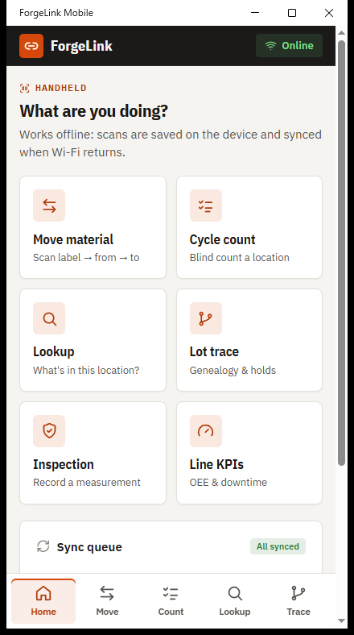

# ForgeLink — Shop-Floor ↔ ERP Integration Platform (.NET 10)

ForgeLink connects a machining plant's **operations technology** (machines, scanners, scales, label printers) to its **ERP**.
It is a working reference system built to show, in one codebase, the skills a manufacturing full-stack .NET role needs:

| You need… | ForgeLink has… |
|---|---|
| **ASP.NET Core MVC** | Integration operations console: outbox backlog, dead letters, retry/cancel, audit trail (`src/ForgeLink.Web/Controllers`, `Views`) + REST API controllers |
| **Blazor (Server / Hybrid)** | Live plant dashboard (OEE, downtime Pareto, throughput, machine board) in Blazor Server; the **same Razor components** run in the MAUI app (`src/ForgeLink.UI`) |
| **WPF** | Operator station for an industrial PC: barcode wedge, weigh-scale count-by-weight, ZPL label printing, offline queue, MVVM + Generic Host (`src/ForgeLink.Desktop`) |
| **.NET MAUI** | Blazor Hybrid handheld app for material moves, blind cycle counts and lot lookup, with offline store-and-forward (`src/ForgeLink.Mobile`) |
| **ERP integration** | Transactional outbox, idempotency keys, per-partition FIFO, exponential backoff + jitter, dead-lettering, incremental master-data sync with watermarks, HMAC-signed webhooks, ERP simulator with fault injection |
| **OT integration** | MQTT telemetry ingestion (state / counts / heartbeats), embedded or external broker, heartbeat watchdog, HTTP gateway endpoint, out-of-order message handling |
| **SQL Server** | EF Core model with constraints, indexes and optimistic concurrency; stored procedures for downtime Pareto, purge and reconciliation (`Persistence/Sql`) |
| **Security** | Microsoft Entra ID (JWT for APIs, OIDC for UI, app roles), device API keys (hashed, constant-time compare), role policies, secure-by-default fallback policy |
| **Auditability / traceability** | Append-only audit trail with before/after values, immutable inventory ledger, lot genealogy (components and where-used), segregation of duties on cycle-count approvals |
| **REST API** | OpenAPI 3.1 document + interactive reference at `/docs`, XML-doc summaries, Idempotency-Key on every command, RFC 9457 problem details, per-caller token-bucket rate limits with `Retry-After`, keyset (cursor) pagination on the inventory ledger |
| **Real-time** | SignalR hub (`/hubs/shopfloor`) plus in-process events: dashboards refresh about 0.4 s after a change instead of polling; devices reconnect with capped backoff and fall back to slow polling |
| **Data pipeline** | Daily OEE rollup: extracts hourly counters and downtime, computes A/P/Q per machine per plant-local day (DST-aware), upserts a reporting table idempotently, recomputes a late-data window; JSON and CSV export, heat-map report page |
| **Engineering practice** | Clean architecture, DI everywhere, 92 automated tests against real SQLite and the real HTTP pipeline, central package management, CI with vulnerability gate, and a CI job that boots the full Docker Compose stack (SQL Server, Mosquitto, simulators) and runs an end-to-end smoke test |

---

## Architecture



Layering (dependencies point inwards):

```
ForgeLink.Domain          entities + business rules (no framework references)
ForgeLink.Contracts       DTOs, IForgeLinkApi, scan parser, webhook signing   ← shared by server and every client
ForgeLink.Application     use cases, ports (IAppDbContext, IErpClient), outbox processor, ERP sync, KPIs
ForgeLink.Infrastructure  EF Core, SQL scripts, HTTP ERP adapter + resilience, MQTT, background workers
ForgeLink.Web             API + MVC + Blazor Server + SignalR + auth (composition root)
ForgeLink.UI              Razor Class Library shared by Blazor Server and MAUI Blazor Hybrid
ForgeLink.Client          typed HttpClient + SQLite offline queue (WPF + MAUI)
ForgeLink.Devices         scale protocol, ZPL labels, TCP/serial adapters + simulators
```

**Current status, where data lives and the integration roadmap: [docs/STATUS.md](docs/STATUS.md).**

### Screenshots

One design system is shared by the Blazor dashboard, the MVC console and the MAUI handheld (`src/ForgeLink.UI/wwwroot/forgelink.css` + an SVG icon sprite): warm graphite neutrals, a dark control-room sidebar and a single forge-orange accent, kept apart from the green / yellow / red status colours. Type is IBM Plex Sans, Sans Condensed and Mono, bundled under the SIL OFL (no CDN), so the handheld renders the same offline. The WPF station embeds the same fonts and palette.

| WPF operator station | MAUI handheld (Windows) |
|---|---|
|  |  |

Deeper write-ups: [docs/architecture.md](docs/architecture.md) (data flows and sequence diagrams),
[docs/operations.md](docs/operations.md) (deployment, change control, runbooks), and the
[architecture decision records](docs/adr).

---

## Run it

Prerequisite: [.NET 10 SDK](https://dotnet.microsoft.com/download). No database or broker install is needed for local runs
(SQLite file + embedded MQTT broker).

```bash
dotnet run --project tools/ForgeLink.ErpSimulator
```

```bash
dotnet run --project src/ForgeLink.Web
```

```bash
dotnet run --project tools/ForgeLink.OtSimulator
```

Then open:

| URL | What |
|---|---|
| http://localhost:5100 | Blazor plant dashboard (OEE, Pareto, machines) |
| http://localhost:5100/integration | MVC integration console (outbox, dead letters, audit) |
| http://localhost:5100/reports/oee | Daily OEE report (rollup pipeline output, CSV download) |
| http://localhost:5100/docs | Interactive API reference (Scalar) over the OpenAPI document |
| http://localhost:5100/openapi/v1.json | OpenAPI document |
| http://localhost:5080 | ERP simulator status: bookings by type, chaos settings |

WPF station (Windows): `dotnet run --project src/ForgeLink.Desktop`.
MAUI app: `dotnet workload install maui-windows maui-android`, then run `src/ForgeLink.Mobile` from Visual Studio, or `dotnet build src/ForgeLink.Mobile -f net10.0-windows10.0.19041.0` (Windows) / `-f net10.0-android` (APK; first run `-t:InstallAndroidDependencies -p:AcceptAndroidSDKLicenses=True` if no Android SDK/JDK is installed).

> If .NET was installed per-user (not under `C:\Program Files\dotnet`), set `DOTNET_ROOT=%USERPROFILE%\.dotnet` before launching the built `ForgeLink.Station.exe` / `ForgeLink.Mobile.exe` directly; otherwise the app host shows "You must install .NET".

Full stack on SQL Server + Mosquitto: `docker compose up --build`, then `bash tools/smoke/stack-smoke.sh` to check it end to end (CI runs exactly this on every push).

### Five-minute demo script

1. **Dashboard** at `/`: machines go Running/Down as the OT simulator publishes; OEE and the downtime Pareto fill in.
2. **Station** (WPF): scan `EMP:1042`, then `WO-24001`, press **Start**, **Weigh & count**, **Report**. A GS1-128 lot label (ZPL) is "printed" to `%LOCALAPPDATA%\ForgeLink\labels`.
3. **Pull the network**: stop `ForgeLink.Web` and report again. The station shows **OFFLINE**, saves to its SQLite queue and still prints the label (lot numbers are deterministic). Restart the server: the queue drains automatically, and idempotency keys make replays safe.
4. **Quality**: `/quality`, record an out-of-spec bore on the new lot. The lot goes on **Hold**; `/inventory/move` refuses to move it except to `QA-HOLD`; `/lots/trace` shows genealogy back to the bar-stock heat.
5. **ERP failure handling**: `curl -X POST "http://localhost:5080/admin/chaos?failureRate=0.6"`. Watch `/integration`: messages retry with backoff and are delivered in order per SKU or work order. A transaction the ERP rejects (4xx) is dead-lettered and blocks only its own partition. Fix it and press **Retry**.
6. **Event-driven ERP**: `curl -X POST http://localhost:5080/admin/work-orders -H "Content-Type: application/json" -d "{\"sku\":\"BRK-2001\",\"quantity\":180,\"line\":\"L1\"}"`. A signed webhook arrives, and the new order appears on `/work-orders` within a second.

### Tests

```bash
dotnet test ForgeLink.Core.slnf
```

* **71 unit tests**: domain rules (overrun tolerance, segregation of duties, out-of-order telemetry, OEE maths), GS1/scale/ZPL parsing,
  and application use cases against a **real relational database** (SQLite in-memory). These cover atomic rollback, outbox ordering and dead-lettering, ERP sync conflicts, optimistic concurrency, the watchdog, cursor pagination (ties, rows inserted mid-walk, tampered cursors) and the OEE rollup (midnight-spanning stops, plant time zone, 25-hour DST day, late data, idempotent re-runs).
* **21 integration tests** boot the real ASP.NET Core pipeline with `WebApplicationFactory`. They cover idempotent replay over HTTP, problem-details codes, API-key and role enforcement, HMAC webhook verification, MVC and Blazor rendering, the offline client draining its queue into the live server, the OpenAPI document, rate limiting (429 + `Retry-After`), CSV export, and a real SignalR client receiving hub events.
* **Stack smoke test** (`tools/smoke/stack-smoke.sh`, CI job `stack`): SQL Server schema and stored procedures, MQTT from the OT simulator through Mosquitto, outbox delivery to the ERP simulator under 15 % injected failures, the rollup on SQL Server, CSV export and pagination.

---

## Key design decisions

* **Transactional outbox, not "call the ERP inline"** ([ADR 0001](docs/adr/0001-transactional-outbox.md)). Production must never stop because the ERP is patching. The business change and its ERP message commit in one database transaction. A dispatcher delivers it later, at least once, and the ERP's idempotency key makes that effectively exactly once.
* **Per-partition FIFO.** Inventory messages are partitioned by SKU and production messages by work order. A failing message blocks only later messages in its own partition, so the ERP never sees a transfer before the receipt it depends on, and one bad SKU does not stall the plant.
* **Store-and-forward on devices** ([ADR 0002](docs/adr/0002-offline-store-and-forward.md)). Wi-Fi dead spots in racking and switch reboots are normal. Commands queue in SQLite (WAL, `synchronous=FULL`) with their idempotency key and replay in order.
* **One UI codebase for web and handheld** ([ADR 0003](docs/adr/0003-shared-blazor-ui.md)). The Razor components depend only on `IForgeLinkApi`. The server binds it in-process (scoped per call, no DbContext held by a circuit), while devices bind it to HTTP with an offline queue.
* **Secure by default.** A fallback authorization policy means every endpoint requires an authenticated user unless it opts out. Devices use hashed API keys, people use Entra ID, and the development scheme refuses to start outside Development.
* **Push, but never depend on it.** Live views subscribe to change events (in-process on the server, SignalR on devices) and coalesce bursts into one reload; a 30 s safety poll keeps a view correct when the connection drops. Events carry only "what changed", and clients re-read over the API, so the hub contract stays tiny.
* **Reporting is a pipeline, not a query.** Daily OEE is computed once into a keyed table (machine, plant day) by an idempotent job with a watermark and a late-data window, so reports are cheap, stable and exportable, and a gateway replaying yesterday's backlog still lands in the right day.
* **Quantities are `decimal(18,4)`, timestamps are UTC end to end** (enforced by EF value converters), and enums are stored as strings for readable SQL and safe reordering.
