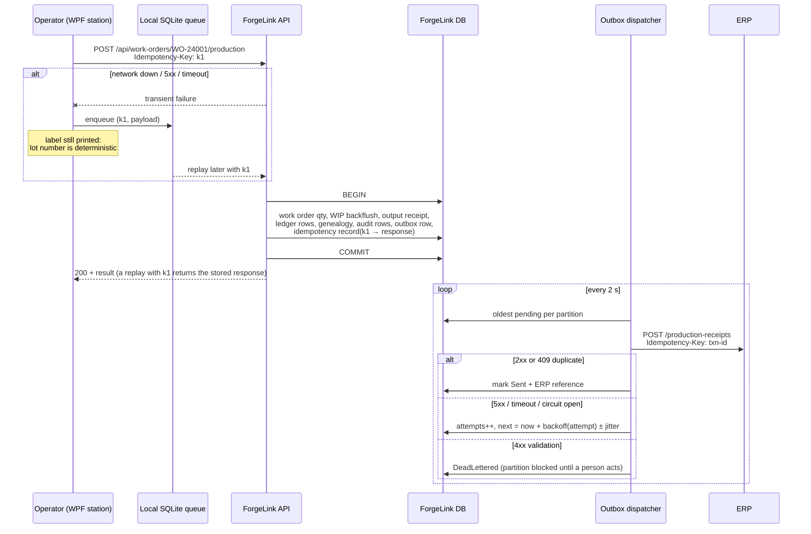

# Architecture and data flows

## 1. Production report (station → ForgeLink → ERP)



There are two idempotency layers, and they solve different problems:

| Layer | Key | Protects against |
|---|---|---|
| Client → ForgeLink | `Idempotency-Key` header, scoped per caller, stored atomically with the business change | Station retries after timeouts, offline replays, double taps |
| ForgeLink → ERP | Outbox `IdempotencyKey` (transaction id) | Dispatcher crash between ERP 200 and `MarkSent`, HTTP-level retries in the resilience pipeline |

## 2. Master data (ERP → ForgeLink)

* **Scheduled pull** (`ErpSyncWorker`, every 60 s): `GET /items?modifiedSince=` and `GET /work-orders?modifiedSince=`.
  The high-water mark is stored in `SyncStates`. Upserts are idempotent, so `>=` on the watermark is safe.
* **Webhook** (`POST /api/erp/webhooks`): verified with HMAC-SHA256 over `"{timestamp}.{body}"`, with a ±5 minute window against replays.
  The body is treated as a hint: ForgeLink re-fetches the authoritative record.
* **Ownership rules**: the ERP owns the item master and the work-order header (quantity, due date, cancellation). The shop floor owns execution.
  A cancellation that arrives while an order is running is **not** applied. It is reported as a conflict for a supervisor.

## 3. OT telemetry

```
plant/{line}/{machine}/state      {"state":"Down","reason":"CHIP_JAM","ts":"…"}
plant/{line}/{machine}/count      {"good":1,"reject":0,"ts":"…"}
plant/{line}/{machine}/heartbeat  {"ts":"…"}
```

* The MQTT client uses a persistent session (`cleanSession=false`) and QoS 1, so the broker queues messages while ForgeLink restarts.
* Device timestamps are honoured, so late (buffered) messages land in the right hour. Messages older than the current state are ignored,
  and timestamps more than 5 minutes in the future are clamped to guard against clock drift.
* Counts aggregate into hourly `ProductionCounters` rather than one row per part, which keeps tables small at high cycle rates.
* `MachineWatchdogWorker` marks a machine **Offline** (opening a `NO_HEARTBEAT` downtime) when its gateway goes silent for 30 s.
* Gateways that cannot speak MQTT can post batches to `POST /api/machines/signals` with an Integration-role API key.

## 4. OEE

`OEE = Availability × Performance × Quality`

* Availability = (planned − unplanned downtime) / planned. Down and Offline count as downtime; Idle shows up as a performance loss.
* Performance = ideal cycle × total count / run time, capped at 100 % so bad ideal-cycle master data is not hidden.
* Quality = good / total (first-pass yield).

On SQL Server the downtime Pareto comes from `dbo.usp_DowntimePareto`, which is set-based and clips events to the window in SQL.
Other providers use the equivalent LINQ implementation, so both sit behind `IDowntimeParetoQuery`.

## 5. Data model highlights

| Table | Notes |
|---|---|
| `WorkOrders` | unique `Number`; `Version` concurrency token; FK to `Items` |
| `InventoryBalances` | unique (`Sku`,`Location`,`LotNumber`); `Version` token, so two handhelds cannot both take the last 10 |
| `InventoryTransactions` | immutable ledger (the audit source of truth); balances are a projection of it |
| `Lots` / `LotGenealogy` | hold status; parent→child edges with quantities for forward and backward trace |
| `OutboxMessages` | identity `Id` defines order; index (`Status`,`Id`); unique `IdempotencyKey` |
| `IdempotencyRecords` | caller-scoped key → request hash + stored response |
| `AuditEntries` | append-only, written in the same `SaveChanges` as the change (JSON before/after) |
| `SyncStates` | watermark, last run, last error per feed |
